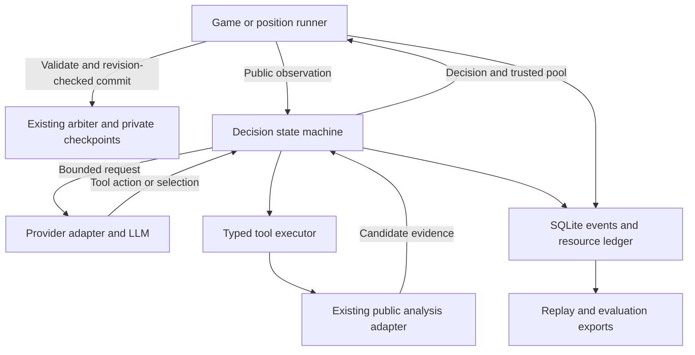

# Scrabble Harness — agent harness implementation plan

Version 1.0 · October 7, 2026 · **Status: proposed implementation**

Build an LLM player that can request Scrabble analysis, choose a move, and finish
each decision within declared resource limits. Measure whether its use of tools
improves the quality–cost tradeoff over simpler policies. Successful delivery
means a working, inspectable system and an honest comparison; improvement is an
experimental result, not an assumption.

This document is the implementation guide for the next phase. It replaces the
remaining harness layout, workflow presets, and schedule in the broader
[original implementation plan](scrabble-harness-technical-implementation-plan.md).
The existing engine architecture remains the foundation.

## 1. Starting point and scope

Already implemented: strict domain models; public observations and canonical
identities; separate analysis and arbiter adapters; isolated native workers;
bounded, seeded two-ply analysis; draw-preserving checkpoints; optional durable
checkpoint storage and diagnostics; full NWL23 with matching leave values.
The latest engine validation passed 250 tests.

The harness must respect current adapter limits: standard English two-player
rules, exchange minimum seven, six scoreless turns, and simulation only when the
bag has at least seven tiles and the opponent has a full unknown rack. Generation
and previews support later positions. Native simulation has its own pinned
termination conventions; its equity estimate is not exact host-game value.

**Required first release:** one provider adapter, at least two model
configurations after a cost pilot, bounded candidate selection and comparison,
fixed and heuristic workflows, a persistent resource ledger, offline replay,
paired position evaluation, and a small full-game demonstration.

**Conditional extensions:** wider candidate presentation, a React viewer, and a
learned router. Deliver these only after the first release works within budget.
Cross-provider comparisons, unaided coordinate-output play, exact endgame
solving, fine-tuning, multi-agent debate, and deployment are later work.

Keep API spending near $100 and use the existing M4 Pro for native analysis.
Aim for a complete first agent in 2–3 focused days and the required release in
roughly 50–65 additional focused hours. These are planning estimates; cut
extensions first if they exceed the remaining three-week project window.

## 2. Architecture and ownership



The harness takes `PlayerObservation`, never `GameState`, an arbiter instance, or
a private checkpoint. It returns a decision; only the runner commits it.
Evaluation reference labels live in a separate store and never enter prompts,
tools, or routing features. An analysis context belongs to one active decision at a time because loading
another observation clears its candidate registry. A serial game runner may
reuse the adapter between turns; concurrent jobs require separate instances.

Use a modular Python application with an explicit async state machine. This
keeps retries, evidence, spending, and terminal conditions visible in project
code. The first release has no agent-framework dependency: these rules are the
project's central behavior, and a generic loop would still need substantial
custom control around them.

## 3. Technologies and decisions

| Technology | Use | Design reason |
| --- | --- | --- |
| Python 3.12+ | Harness, runners, evaluation | Shares the existing engine/domain package and avoids another service boundary. |
| Pydantic 2 | Actions, events, configuration, provider normalization | Matches current strict records and checks every external action. |
| `asyncio` | Model requests, deadlines, tool execution | Fits the existing async engine interfaces. |
| Official OpenAI Python SDK + Responses API | First provider | Direct access to usage and function-call data; isolate it behind a small provider protocol. |
| `sqlite3` + SQLite | Events, reservations, attempts, job state | Local transactions without operating a database service. |
| JSON/JSONL | Configuration and replay exports | Explicit schemas and easy inspection; JSONL is an export, not a second authoritative journal. |
| `hashlib`, `Decimal`, monotonic clock | Fingerprints, cost conversion, elapsed limits | Deterministic identities, integer money, and elapsed time unaffected by clock changes. |
| `argparse`, pytest | CLI and verification | Small dependency footprint; real state-machine and failure tests. |
| NumPy + Matplotlib | Paired analysis and saved figures | Local, reproducible reports that do not require API calls. |
| React + TypeScript + Vite, optional | Replay viewer | A static client can read saved traces without server-held keys. |
| scikit-learn, optional | Small workflow router | A tabular model fits the amount of training data and local hardware. |

Pin new dependency versions when implementing and record them in execution
manifests. Keep the existing MAGPIE/NWL pins during initial experiments.
OpenAI provides an official Python SDK and documents function tools for
Responses. [SDK documentation](https://developers.openai.com/api/docs/libraries),
[function calling](https://developers.openai.com/api/docs/guides/function-calling).
SQLite transactions support the ledger design. [SQLite transactional behavior](https://www.sqlite.org/transactional.html).
Optional frontend and learning references: [Vite](https://vite.dev/guide/),
[scikit-learn ensembles](https://scikit-learn.org/stable/modules/ensemble.html).

## 4. Package layout and contracts

Add these modules incrementally; the tree describes planned files:

```text
src/scrabble_harness/
  domain/                    # Existing records and identities
  engine/                    # Existing adapters; planned shared turn helper in recovery
  harness/
    contracts.py             # Actions, limits, outcomes, evidence
    context.py               # Frozen pool, visible handles, issued evidence
    prompts.py               # Versioned observation/candidate presentation
    tools.py                 # Validated tool dispatch and analysis tiers
    loop.py                  # Bounded decision state machine
    policies.py              # Fixed presets, fallback, heuristic routing
    budget.py                # Per-decision resource enforcement
  providers/
    protocol.py              # Request, reply, usage, capabilities
    openai.py                # SDK-specific translation and continuation
    fake.py                  # Scripted provider for offline checks
  runs/
    store.py                 # SQLite migrations and durable events
    ledger.py                # Transactional reservations and settlements
    runner.py                # Position jobs, game turns, reconciliation
    replay.py                # Replay and public export
  evaluation/
    positions.py             # Reachable corpus and grouped manifests
    references.py            # Separate higher-budget engine jobs
    metrics.py               # Paired results, costs, uncertainty
    report.py                # CSV/JSON and figures
  cli.py
configs/harness/              # Versioned experiment JSON
tests/harness/                # Scripted decisions and budget/failure tests
tests/providers/              # Provider-format fixtures
tests/runs/                   # Restart and accounting scenarios
web/                          # Optional viewer
```

Minimal project-facing interfaces:

```python
class ModelProvider(Protocol):
    async def complete(self, request: ModelRequest) -> ModelReply: ...

async def decide(
    observation: PlayerObservation,
    analysis: AnalysisEngine,
    config: HarnessConfig,
    ledger: ResourceLedger,
    store: RunStore,
) -> DecisionOutcome: ...
```

`DecisionOutcome` contains the canonical `AgentDecision`, trusted pool, visible
candidate IDs, issued evidence IDs, actual usage, and terminal reason. The
runner uses existing `validate_decision(...)`, then
`arbiter.commit(move, expected_revision=...)`. No change to the native C engine
is required. The recovery stage includes a small host-side refactor to share
existing turn-transition logic, described below.

Retain existing `RunConfig`, `RunLimits`, and `ModelSettings`. Add
`HarnessConfig` for workflow, presentation, tool limits, prompt/schema versions,
and provider options; `DecisionLimits` for turn-level caps; and
`ExecutionManifest` binding the complete configuration to the engine
fingerprint, code/dependency versions, rate card, and trial identity.

## 5. Decision context and candidate presentation

Generate one host-owned pool of 40 candidates using the existing adapter.
Freeze it for the decision: rerunning generation would replace its registry.
Reserve a legal fallback before making a paid request, using the best static
candidate in the pool. Abort the decision explicitly if preparation cannot
produce a validated pool; a native failure must not become an unvalidated move.

Initially display 12 candidates. Reserve the fallback and configured
pass/exchange options when available, then fill from remaining static candidates. Shuffle their presentation using the recorded candidate
order seed. Give them short, decision-scoped handles such as `c01`; map handles
to full canonical IDs in trusted code. Assign handles after shuffling so their
numbers do not expose native rank. Persist the mapping.

The primary presentation includes the public board, premiums, blank flags,
own rack, scores, public unseen inventory, move placements, exact move score,
and leave. Omit static equity and native rank from the primary model view;
add a separate rich-metadata ablation later. Otherwise selecting the largest
displayed engine estimate could dominate the task. All principal LLM policies
receive the same presentation and candidate order for a position/trial.

Limit retained public history deterministically in prompts and record that
policy. Preserve the complete observation in local records. Never truncate
provider continuation items ad hoc; enforce a request-size ceiling before
dispatch and use fallback when a conversation would exceed it.

## 6. Tool surface

The first release exposes two tools. All arguments are strictly validated,
including semantic checks after provider schema validation:

| Tool | Arguments | Host behavior |
| --- | --- | --- |
| `select_move` | `candidate_handle`, `evidence_ids`, `brief_note` | Resolve a currently visible handle, validate evidence, and finish the decision. It does not commit. |
| `compare_moves` | 2–4 distinct visible handles, tier `light` or `standard` | Resolve canonical IDs, reserve work/time, call `analysis.analyze`, and return bounded evidence. |

Example logical arguments:

```json
{"candidate_handles":["c03","c09"],"tier":"light"}
```

```json
{"candidate_handle":"c03","evidence_ids":["e01"],"brief_note":"Preferred after the bounded comparison."}
```

Tool results include a host-issued evidence ID, observation ID, compared handles,
estimated equity, available standard errors, total reported work, seed,
elapsed time, and completion status. Validate that cited evidence exists in
this decision; a note is a short explanation, not proof of reasoning quality.

Initial tiers are **60 and 300 total candidate rollouts**. Deep allows up to
600 rollouts across its comparisons. These are pilot settings, not calibrated
performance claims. Tier settings are host-controlled; models cannot choose
arbitrary iterations, native commands, files, or new moves. Disable comparison
before prompting when the position is outside the adapter's simulation scope.

Optional tools after the core works: `show_more_candidates` reveals up to eight
more candidates from the frozen pool, and `preview_move` shows a selected
candidate's resulting board through the existing preview API. Both consume
tool steps and elapsed time. They add no new search coverage. Report wider
presentation as an intervention and keep it out of the first fixed comparison.

## 7. Provider integration and prompt protocol

Start with `AsyncOpenAI` and Responses function calling. Use separate function
schemas with explicit strict mode, no additional object properties, and all
fields required; nullable fields express optional values. Disable parallel
tool calls and enforce one action per reply in the host as well. Preserve
function-call IDs and provider-required continuation items between rounds.
These details follow [OpenAI function-calling guidance](https://developers.openai.com/api/docs/guides/function-calling).

Keep conversation continuation in the provider adapter. Use `store=False` and
explicit local continuation; do not make resume depend on a remote conversation
ID. Opaque continuation items belong in private run storage, outside the viewer.
Local replay uses recorded visible actions and results, not hidden reasoning.

`ModelReply` retains response/request IDs, resolved model, normalized actions,
visible text/refusal, finish status, usage, and the provider envelope needed for
continuation. Record input, cached-input, and output usage where supplied.
Reasoning-token breakdowns must not be charged twice when already included
in output usage. Output caps must account for reasoning tokens where applicable; provider tool
limits do not replace our custom-tool ledger. [Responses reference](https://developers.openai.com/api/reference/python/resources/responses/methods/create).

Disable SDK-managed automatic retries in the pinned client and verify that
setting with a transport test. The harness owns every retry and reservation.
Declare supported model parameters in provider capabilities; reject unsupported
temperature/reasoning options during preflight rather than silently changing
the experiment.

Prompts state the objective, public-information boundary, tool rules, available
handles, remaining limits, and required terminal action. No unrestricted text
parser guesses a move. Empty, malformed, refused, or multiple-action responses
produce a recorded failure and, if affordable, one repair round inside the same
budget. On the last permitted request, expose only `select_move`.

Select actual model IDs after a small cost/capability pilot. Freeze model IDs,
effective settings, prompts, schemas, and the SDK version for evaluation.
API reruns are fresh stochastic trials; local seeds do not guarantee identical
model output. Add a second model using the same provider adapter first, then
consider a second provider if time and spend permit.

## 8. State machine, presets, and termination

```text
PREPARE -> ROUTE -> RESERVE_MODEL -> REQUEST_MODEL -> VALIDATE_ACTION
    -> SELECT -> VALIDATE_DECISION -> RETURN
    -> RESERVE_TOOL -> EXECUTE_TOOL -> RECORD_EVIDENCE -> REQUEST_MODEL
    -> REPAIR, FALLBACK, or ABORT
```

Every transition is durable before the corresponding external action. Use one
absolute monotonic deadline per decision, starting before preparation. Invalid
actions consume their request/step allowance. Before executing any nonterminal
tool, reserve capacity for a final selection request, including the bounded
tool-result input. Limit the HTTP timeout and each `AnalysisLimits` deadline to
the remaining decision time, keeping a configurable finish reserve. A transport retry
uses another attempt slot and cost reservation; an ambiguous timeout uses
fallback by default and leaves its original charge unresolved.

| Preset | Model-attempt ceiling | Nonterminal tool-step ceiling | Rollout ceiling |
| --- | ---: | ---: | ---: |
| Fast | 1 | 0 | 0 |
| Standard | 2 | 1 | 300 |
| Deep | 3 | 2 | 600 |

These are maximum allocations. Early selection ends the decision. Default
output cap is 1,024 tokens per request, subject to the chosen model's pilot.
Initial decision limits are 30 seconds and $0.03; configure both explicitly
and revise them from measurements before freezing experiments.

Fallback order: retain a validated final selection if one exists; otherwise
choose the largest estimate from the latest usable comparison batch when
the configured fallback policy permits it; otherwise use the cached static fallback. Record origin and
reason. Engine recovery or commit failure can abort a turn/run; it cannot
silently accept an illegal action. Final validation/cleanup may exceed the
decision deadline, so this is a bounded scheduling policy, not a real-time
latency guarantee.

## 9. Four resource limits and conservative accounting

Enforce API cost, dispatched model attempts, native rollout work, and elapsed
time independently, at both decision and run level. Keep a separate tool-step
cap for repeated invalid or cheap requests. Static generation and previews
consume time and operation counts; they are not candidate-rollout work.

Store costs as integer microusd, matching existing `RunLimits`; use `Decimal`
for rate-card arithmetic and round reservations upward. Freeze a rate card
with pricing source, retrieval date, currency, model/tier, token categories,
and estimation method. Consult current [official pricing](https://developers.openai.com/api/docs/pricing)
when configuring the pilot; do not hard-code prices into application logic.

Before dispatch, transact a reservation for bounded input cost plus the maximum
output cost and a safety margin. Use a verified token-count method or a
documented conservative bound covering tool schemas and continuation items;
refuse dispatch if no defensible bound is available. Reserve using uncached
input rates, then settle cache discounts only from reported usage. The ledger
is a dispatch bound based on a rate card, not a guarantee of provider invoices.

Reservation states: `reserved -> dispatched -> settled`, or
`dispatched -> unresolved`. An attempted request with unknown usage retains
its reserved charge until reconciliation. Release only work proved not to have
been dispatched. A timeout or cancellation does not prove an API request was
unbilled. Persist and count each explicit HTTP attempt. Settle reported usage even when
its model action is malformed or refused; action validation cannot erase cost.

Reserve native work before analysis. Settle to reported work on a usable result;
keep the full allowance charged against admission when a killed request has
unknown work. Report confirmed work and unresolved allowance separately.
Do not fabricate zero usage after a crash. A stale reservation discovered on
restart is unresolved by default because a crash could occur around dispatch.

Use one SQLite transaction to admit reservations against campaign, run, and
decision scopes, preventing competing jobs from overspending their shared caps. Begin with one run writer and one active decision; later add a
small bounded semaphore for independent position jobs. Single-thread native
settings remain unchanged for controlled comparisons.

## 10. Storage, recovery, and replay

SQLite is authoritative for harness events and accounting. Tables:

- `campaigns`: project-wide spending cap and shared reservation totals.
- `runs`: campaign ID, execution manifest, status, aggregate caps, creation time.
- `decisions`: observation, frozen pool/handle map, workflow, status, outcome.
- `attempts`: unique attempt ID, dispatch state, request hash, provider IDs, response, usage.
- `reservations`: cost/work/call allocations and settlement state.
- `events`: per-run sequence, decision ID, type, validated payload.
- `commits`: decision ID, game ID, expected/new revision, move, checkpoint ID.

Use foreign keys, uniqueness on `(game_id, expected_revision)` for commit
intents and `(game_id, new_revision)` for confirmations, and durable local
transactions. Hold a per-game advisory filesystem lock for the active runner;
use `fcntl` on the initial macOS/Linux target. Do not permit two runners to
advance the same game. Ledger admission still uses database transactions.
Configure WAL with `synchronous=FULL`; avoid a network-mounted run database. [SQLite WAL documentation](https://www.sqlite.org/wal.html).
The existing private `CheckpointStore` remains authoritative for game state;
the existing `TraceJournal` remains optional native diagnostics.

Before implementing reconciliation, extract the existing arbiter's turn
application into one pure, tested host helper used by both commit and recovery.
It takes the private source state, validated preview, and rules/configuration
and produces the next state using the existing draw helpers. Native legality
validation stays inside the arbiter. This avoids a second implementation of
exchange draws or terminal scoring. Re-run the engine suite after the refactor.

There is no atomic transaction across SQLite and checkpoint files. Handle it:

1. Persist `commit_intent` containing the selected move, expected revision,
   and source checkpoint identity.
2. Commit through the arbiter with durable checkpoint storage enabled.
3. Persist `commit_confirmed` containing the resulting checkpoint identity.
4. On restart, compare intent with the latest validated checkpoint. For a
   published next revision, derive the intended transition from the source
   checkpoint and a validated public preview, using the shared helper; compare
   its complete checkpoint identity. Exchanges expose only a count in public
   history, so history alone cannot prove which physical tiles were exchanged.
   A matching transition finalizes the record without another commit. If no
   turn was published, reuse the saved decision. Unexpected revision, identity,
   or transition conflicts stop recovery for inspection.

Similarly, save a complete provider reply before tool execution. Resume from
that reply without another paid request. An attempt dispatched without a saved
reply remains unresolved; do not automatically replay it. For native evidence,
reuse saved results. Permit deterministic reruns only under a new recorded
attempt and work reservation; never erase the interrupted work allowance.

Provide two explicit modes: **replay** makes no API/engine calls and reuses
recorded events; **new trial** assigns a new trial identity and invokes providers.
Cache keys include observation, pool/presentation, engine fingerprint,
model/settings, prompt/schema versions, workflow, analysis seed/work, and
trial identity. Keep charges attached to the original attempt so resume does
not count saved responses as newly billed requests.

Keep run records and opaque provider envelopes under ignored `private/` paths.
Export an allowlisted JSONL/JSON bundle for viewing: public position, displayed
candidates, visible actions/evidence, selected move, timing, costs, and fallback.
Omit private checkpoints, credentials, continuation payloads, and unrevealed
candidate data. In a full-game replay, label each turn's player perspective.

## 11. Routing and the role of learning

Implement fixed presets first. Then add a deterministic heuristic using only
pre-decision features: game phase, board occupancy, own rack/blanks, score
difference, static candidate gaps, and remaining resources. Candidate pool
size is not the number of all legal moves. Disable search routes outside the
engine's simulation scope. Tune routing thresholds on development positions.

A learned router is optional after fixed/heuristic comparisons. Collect matched
Fast/Standard/Deep outcomes on training positions. Predict workflow reference
loss and resource use separately with small scikit-learn models. Choose the
cheapest feasible workflow within a development-chosen quality tolerance of
the best prediction. Save the feature schema, training manifest, and model hash.

Training labels must describe actual LLM workflow outcomes. Extra native search
alone cannot establish which LLM workflow is better. Validate by source-game
groups and keep the final test corpus out of feature/prompt/threshold tuning.
Ship the heuristic if learning offers no convincing improvement or the paired
label collection cannot fit the remaining budget.

## 12. Evaluation design

Generate reachable positions locally from several native policies. Retain source
game/seed family, turn, phase, and tags for blanks, exchanges, and crowded boards.
Group splits by source game and seed family, deduplicate observations, and freeze
the test manifest before final tuning. Keep imported synthetic transition
fixtures out of the performance corpus.

Initial paid target: 80–120 supported opening/midgame positions, two model
configurations, and Fast/Standard/heuristic policies. Size it after the pilot:

```text
projected spend = positions × models × policies × measured mean cost per decision
```

Include expected retries, repetitions, and full-game calls in that forecast.
Repeat a smaller subset to estimate model variability. Later-game positions
remain a separate selection/fallback coverage test until reference analysis is
supported; do not mix them into simulated-equity loss.

Required non-LLM baselines: highest exact score, best static equity, and automatic
budgeted engine comparison. The latter spends the same declared rollout cap
and chooses the largest reported estimate, using a frozen shortlist rule.
These reveal whether LLM tool allocation adds value beyond engine access.

Reference evaluation is a separate local job over the frozen 40-candidate pool,
with higher work allowances and independent seeds. Start with three seeds and
up to 3,000 rollouts per candidate/seed, calibrating local runtime first. Analyze
one candidate per request or record explicit per-candidate counts before
aggregating: current `AnalysisResult` exposes total work, not sample counts for
each candidate in a batch. Split work into bounded requests if necessary.

Require the configured sample target and usable completion status for a full
reference; mark insufficient or interrupted references unresolved. Combine
replications with their recorded counts and retain variability. Define loss as
best evaluated pool equity minus selected equity under this reference protocol.
Call it **estimated loss within the evaluated pool**, never global optimality.
Keep native-rule limitations and uncertain close comparisons visible.

Export one row per position/model/policy/trial: raw selection validity, final
move, fallback origin, reference coverage/loss, requests, estimated API cost,
confirmed/unresolved work, elapsed time, and status. Report raw model behavior
and final served behavior separately so a strong fallback does not get credited
as model skill. Compare policies with paired differences and uncertainty
resampled by source game. Show cost and engine work as separate axes.

Use a small game batch with rotated starting seats to demonstrate sustained
play. Report scores and failures without deriving a precise Elo from that batch.
Negative results are valid: a useful harness can establish that automatic
engine selection is cheaper or stronger than its LLM policies.

## 13. CLI and optional viewer

Implement `scrabble-harness` through `argparse` with these planned commands:

```text
decide       Run one position with a configured model/workflow
play         Run a complete game with durable checkpoints
resume       Reconcile and continue an interrupted run
replay       Inspect/export a recorded decision without paid calls
evaluate     Run a frozen position/policy/model matrix
report       Produce metrics and figures from saved results
```

Default to explicit config files and a preflight spend forecast. Offline tests
and replay require no API key. A future paid run must have credentials, a known
rate card, and explicit run caps; this planning task makes no paid requests.

If the core is complete, build a static React/TypeScript viewer that loads an
export bundle. Prioritize board/rack state, candidate placements, a decision
timeline, evidence, actual resource use, fallback status, and paired policy
comparison. Use recorded examples; live reruns and a web backend are optional.

## 14. Implementation order and gates

| Step | Estimated hours | Deliverable and acceptance gate |
| --- | ---: | --- |
| 1. Contracts and presentation | 4–5 | New strict records, frozen pool/handles, prompt snapshots; hidden-state mutations cannot change provider input. |
| 2. Run store and resource ledger | 6–8 | Events and transactional reservations; concurrent admission, uncertain charges, and restart accounting work offline. |
| 3. Provider and scripted harness | 6–8 | Fake provider, SDK translation, bounded loop; malformed actions, refusal, duplicate calls, and each ceiling end predictably. |
| 4. Tools and one-model pilot | 6–8 | Real compare/select path, preserved evidence, measured usage; complete position decision and a small cost pilot. |
| 5. Game runner and recovery | 6–8 | Durable game; injected crashes around response saving and commit publication reuse work and avoid duplicate turns. |
| 6. Fixed/heuristic evaluation | 12–16 | Grouped corpus, references, second model, baselines, frozen paired comparison; report can rerun from saved results. |
| 7. Release documentation and examples | 4–6 | Clean setup, replay bundle, exported figures, usage guide, and a short demo. |

Required work totals roughly **44–59 hours**, with a contingency bringing the
planning allowance to 50–65. Add a viewer in 6–10 hours or a learned router in
8–12 hours only after the required gates pass; both also need experiment budget.

Tests should exercise behavior: stale/unknown handles, forged evidence,
over-budget tools, unsupported game phases, explicit retries, missing usage,
deadline exhaustion, and restart at every external side-effect boundary.
Use scripted providers and fake transports for most cases, plus a small native
integration set. Paid tests are opt-in; ordinary CI never contacts a provider.
Retain the existing 250-test engine suite and run it when integration changes
touch those boundaries.

## 15. Spend allocation and completion checklist

| API category | Planned ceiling |
| --- | ---: |
| Capability/cost pilot | $5 |
| Development and repairs | $20 |
| Frozen multi-model position evaluation | $50 |
| Repetitions and short full-game demos | $15 |
| Unresolved charges and contingency reserve | $10 |
| Total | **$100** |

Preserve the reserve by limiting normal dispatch to $90 across the experiment
campaign, including its separate runs. Add a shared campaign cap so creating
another run cannot reset the project spend allowance. Learned-router labels
must fit development funds or a deliberately revised experiment allocation.
Reduce position/model counts before increasing the budget.

The release is complete when a configured model can play a valid complete game;
all decisions obey declared admission limits or report unresolved work; crashes
resume safely; an exported decision can be inspected offline; at least two
models and simple engine baselines have comparable frozen results; and the
report attributes improvements, failures, fallback use, and resource costs
accurately. Include a learned router only if its measured contribution supports
the extra complexity.
